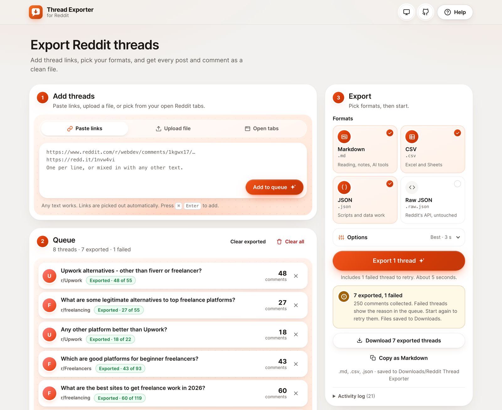
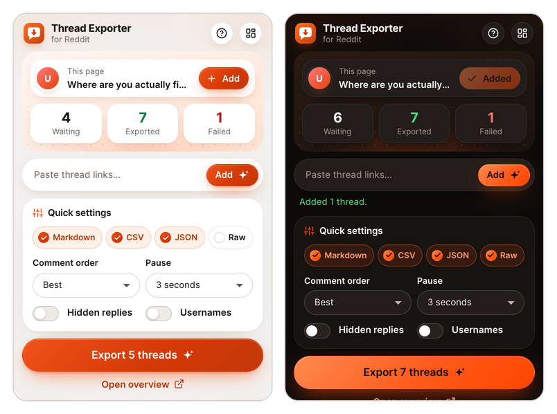
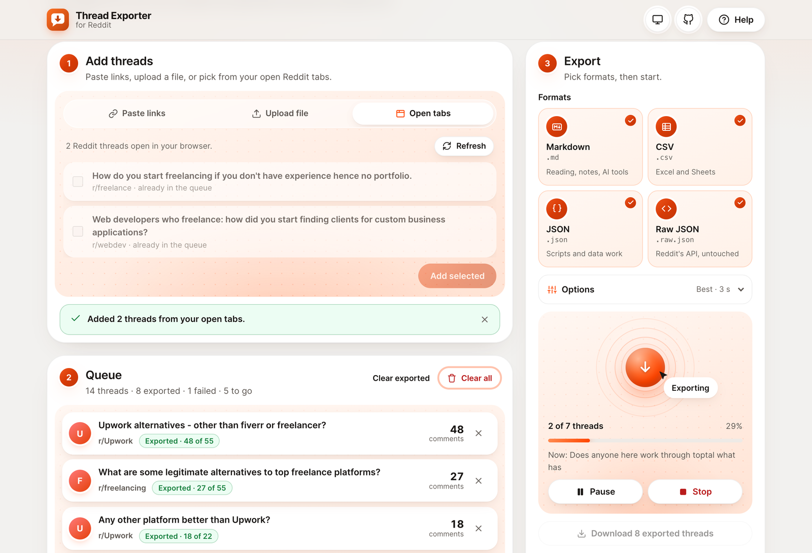
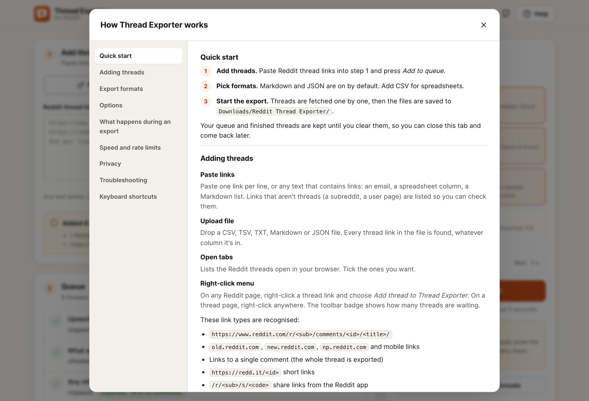
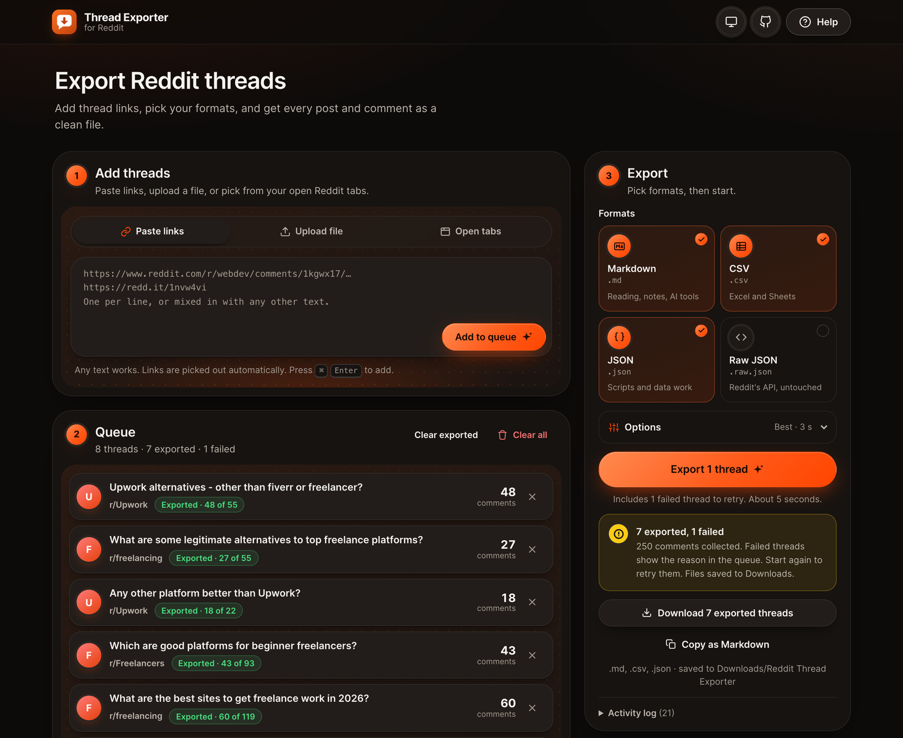
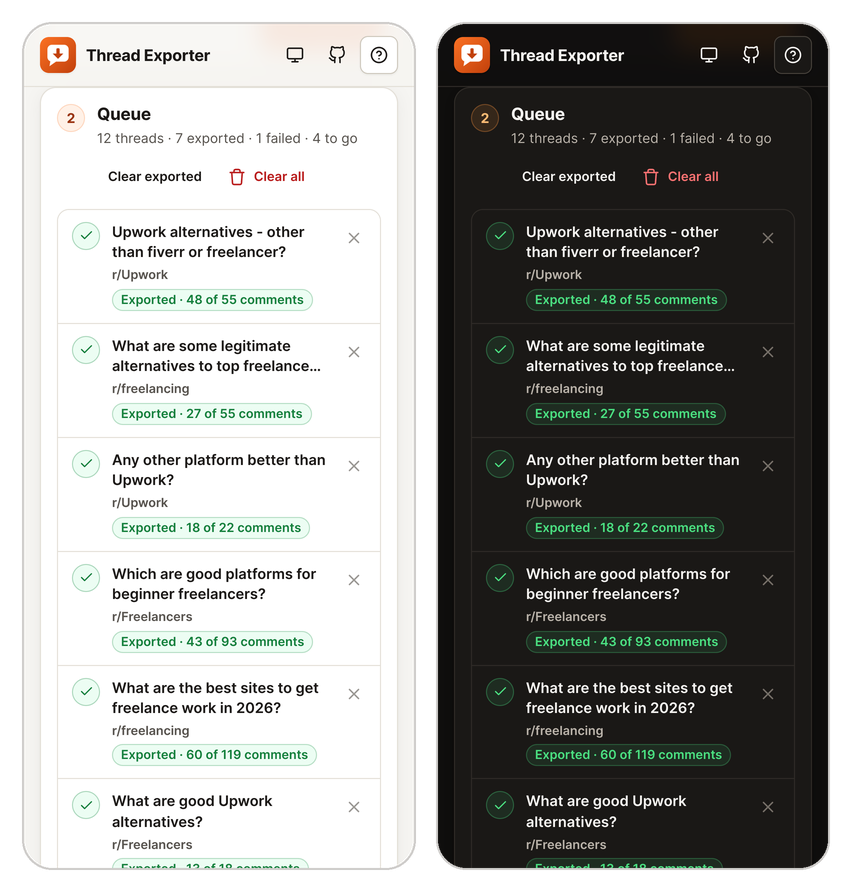
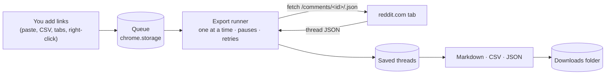

<div align="center">


# Thread Exporter for Reddit

**Turn Reddit threads into clean Markdown, CSV or JSON, in bulk, from your own browser.**

Paste links or drop a CSV, press Export, and the files land in your Downloads folder.

[](https://github.com/AleksKamb/reddit-thread-exporter/actions/workflows/ci.yml)
[](https://developer.chrome.com/docs/extensions/develop/migrate/what-is-mv3)
[](package.json)
[](LICENSE)

[Install](#install) · [How to use it](#how-to-use-it) · [Formats](#export-formats) · [How it works](#how-it-works) · [Security](#privacy-security-and-permissions) · [Development](#development)



</div>

## Why

Reading 30 Reddit threads to research a market, a product or a career move takes an afternoon. Copying them into notes takes another. And Reddit blocks most scripts that try to download threads for you.

Thread Exporter does it from inside your own browser, the same way reddit.com loads comments, so it just works. You get one tidy file with every post and comment, ready for reading, a spreadsheet, or an AI tool.

## Features

- **Add threads any way you like.** Paste links, drop a CSV or text file (links are found in any column), tick open Reddit tabs, right-click any thread link on Reddit, or add the thread you're reading from the toolbar popup.
- **Quick settings in the toolbar.** The popup shows your queue and live progress, adds the current thread in one click, takes pasted links, jumps to file upload, and has the most-used settings, with a link to the full overview.
- **Understands every Reddit link.** Full URLs, `old.` / `new.` / mobile links, comment permalinks, `redd.it` short links, app share links (`/r/…/s/…`) and bare `/r/…/comments/…` paths. Duplicates are skipped and non-thread links are flagged.
- **Four formats.** Readable Markdown with nested replies, an Excel-ready CSV, a clean JSON tree, and Reddit's raw JSON. Or one click to copy the Markdown.
- **Polite and resilient.** One request at a time with a pause in between. Waits out rate limits on its own, retries temporary errors, and tells you exactly why a thread failed.
- **Never loses work.** Pause, resume or stop at any time. Finished threads are saved as they complete and survive a closed tab.
- **Optional extras.** Load the replies hidden behind "load more replies", choose the comment order, include usernames (off by default).
- **Private and locked down.** No server, no analytics, no tracking. It only talks to reddit.com, runs under a strict content security policy, and protects CSV exports against formula injection.
- **Built-in help**, light and dark themes, keyboard support, and a layout that works in a narrow window.

<table>
  <tr>
    <td width="50%"></td>
    <td width="50%"></td>
  </tr>
  <tr>
    <td align="center"><sub>The toolbar popup: current thread, queue and quick settings</sub></td>
    <td align="center"><sub>Live progress; rate limits are waited out for you</sub></td>
  </tr>
  <tr>
    <td width="50%"></td>
    <td width="50%"></td>
  </tr>
  <tr>
    <td align="center"><sub>Built-in help covers every option and common problems</sub></td>
    <td align="center"><sub>Follows your system's dark mode, or pick a theme</sub></td>
  </tr>
  <tr>
    <td colspan="2" align="center"><br /><sub>Works in a narrow window or side panel</sub></td>
  </tr>
</table>

## Install

The extension works in Chrome 116 or newer, and in other Chromium browsers (Edge, Brave, Arc, Opera).

**From a release (no tools needed)**

1. Download `reddit-thread-exporter-v1.2.0.zip` from the [latest release](https://github.com/AleksKamb/reddit-thread-exporter/releases/latest) and unzip it.
2. Open `chrome://extensions` and turn on **Developer mode** (top right).
3. Click **Load unpacked** and select the unzipped folder.
4. Pin the extension from the puzzle-piece menu so the button is always one click away.

**From source**

```bash
git clone https://github.com/AleksKamb/reddit-thread-exporter.git
```

Then follow steps 2–4 above and select the cloned folder. No build step is needed.

## How to use it

1. **Open the exporter.** Click the toolbar button for the quick popup, then **Open overview** for the full page. On first install the page opens by itself.
2. **Add threads.** Paste links into the box and press **Add to queue** (or <kbd>⌘</kbd>/<kbd>Ctrl</kbd> + <kbd>Enter</kbd>). You can also upload a file, pick from your open tabs, or right-click a thread link on Reddit and choose **Add thread to Thread Exporter**.
3. **Pick formats** in the Export panel. Markdown and JSON are on by default.
4. **Press Export.** Threads are fetched one by one. When the queue is done, the files are saved to `Downloads/Reddit Thread Exporter/`.

**From the toolbar popup** you can do the quick things without opening the page: add the thread you're reading, paste a link, change formats and options, and press **Export**. The upload icon next to the paste field opens the page on **Upload file**, ready for your CSV. The export then runs in the overview page, and the popup shows its progress.

If you're not logged in to Reddit, or Reddit wants to check your browser, open reddit.com once in a normal tab first. The help page (**Help** in the top bar, or <kbd>?</kbd>) covers every option and the common problems.

### Options

| Option | Default | What it does |
| --- | --- | --- |
| Comment order | Best | Best, Top, New, Controversial, Old or Q&A, the same as on Reddit |
| Pause between requests | 3 s | 2, 3, 5 or 10 seconds. Longer is gentler on Reddit |
| Load hidden replies | Off | Also fetches comments behind "load more replies" (up to 10 extra requests per thread) |
| Include usernames | Off | Adds post and comment authors to the export |
| Download when finished | On | Saves the files as soon as the export completes |
| File name | dated | e.g. `reddit-threads-2026-10-17-1430` |

## Export formats

| Format | Best for | Shape |
| --- | --- | --- |
| **Markdown** `.md` | Reading, notes, AI tools | Heading per thread, post text, nested comment list with scores |
| **CSV** `.csv` | Excel, Google Sheets, analysis | One row per post and comment, with parent, depth, score and date |
| **JSON** `.json` | Scripts and data work | Threads with nested `replies` and documented fields |
| **Raw Reddit JSON** `.raw.json` | Developers | Reddit's API responses, untouched |

The shape of the Markdown export (comment text shortened):

```markdown
## r/Upwork: Upwork alternatives - other than fiverr or freelancer?

2025-09-20 · 28 points · 48 of 55 comments · [Open on Reddit](https://www.reddit.com/r/Upwork/comments/1nlunhn/…)

The post's text…

### Comments (48)

- 13 points: A top-level comment…
  - **OP** · 4 points: A reply from the person who started the thread…
    - 2 points: Replies nest as deep as the conversation goes…
```

Every field of every format is described in [docs/OUTPUT-FORMATS.md](docs/OUTPUT-FORMATS.md).

## How it works

Reddit blocks most requests that don't come from a real browser session. So instead of calling Reddit from a server or a script, the extension asks Reddit for each thread **from inside a reddit.com tab**, exactly like Reddit's own page does when it loads comments. If no Reddit tab is open, it opens one in the background and closes it at the end.



The parts that don't need Chrome (link parsing, the runner, the thread model and the formatters) are plain functions with unit tests. The details, including the design decisions, are in [docs/ARCHITECTURE.md](docs/ARCHITECTURE.md).

## Privacy, security and permissions

Everything happens in your browser. There is no server, and the extension sends nothing anywhere except the requests to reddit.com for the threads you added. Usernames are left out of exports unless you turn them on. Full details: [PRIVACY.md](PRIVACY.md).

Reddit content and uploaded files are treated as untrusted input:

- Text from Reddit is only ever displayed as text, never as HTML (enforced by ESLint).
- Extension pages run under a strict content security policy and can't be loaded or messaged by websites.
- CSV exports are protected against formula injection, and exported links can only point to reddit.com threads or ordinary web pages.
- Look-alike domains are rejected, uploads are size-limited, and link scanning can't be slowed down by crafted files.

The threat model and how to report a vulnerability are in [SECURITY.md](SECURITY.md).

| Permission | Why it's needed |
| --- | --- |
| Read and change data on www., old. and new.reddit.com | Runs the thread request inside a reddit.com tab, and lets the popup offer the thread you're viewing |
| `scripting` | Injects that one request function into the tab |
| `storage`, `unlimitedStorage` | Keeps your queue, settings and exported threads on your computer |
| `downloads` | Saves the files to your Downloads folder |
| `contextMenus` | Adds "Add thread to Thread Exporter" to the right-click menu |

## Responsible use

This tool is for personal research, note-taking and analysis of public discussions. Please respect [Reddit's User Agreement](https://redditinc.com/policies/user-agreement), keep the default pause between requests, and be thoughtful with what people wrote, especially if you include usernames. Don't use it to republish content or to build datasets for commercial use.

## Limitations

- Reddit returns up to about 500 comments per request. **Load hidden replies** fetches most of the rest, but very deep "continue this thread" chains are not followed.
- Deleted and removed comments are left out, unless someone replied to them.
- Private, quarantined and banned communities can only be exported if your Reddit account can see them.
- Chromium browsers only. Firefox would need a few changes (see the roadmap).

## Development

No build step and no runtime dependencies. Node 20+ is only needed for linting and tests.

```bash
npm install          # ESLint for development
npm test             # unit tests (Node's built-in test runner)
npm run lint
npm run check        # lint + tests + manifest validation
npm run package      # dist/reddit-thread-exporter-v<version>.zip
```

```text
reddit-thread-exporter/
├── manifest.json            Manifest V3: permissions, icons, service worker
├── _locales/en/             Extension name and description
├── icons/                   Toolbar and store icons (drawn by scripts/make-icons.py)
├── src/
│   ├── background.js        Right-click menu, badge, first-run page
│   ├── app/                 The exporter page: index.html, app.css, app.js
│   ├── popup/               The toolbar popup with quick settings
│   ├── shared/              Theme tokens and components, icon sprite, DOM helpers
│   └── lib/
│       ├── reddit-links.js  Recognises and extracts Reddit links
│       ├── export-runner.js Queue processing, pacing, retries, pause/stop
│       ├── thread-model.js  Normalizes Reddit's JSON into a comment tree
│       ├── formatters.js    Markdown, CSV and JSON output
│       ├── reddit-tab.js    Runs requests inside a reddit.com tab
│       ├── app-tab.js       Opens/focuses the exporter and passes it commands
│       └── store.js         chrome.storage: queue, settings, saved threads, progress
├── test/                    Unit tests with made-up Reddit fixtures
├── scripts/                 Manifest check, packaging, icon generator
└── docs/                    Architecture, output formats, images
```

Contributions are welcome: see [CONTRIBUTING.md](CONTRIBUTING.md). Security issues: [SECURITY.md](SECURITY.md).

## Roadmap

- Firefox build (Manifest V3 with `browser.*` APIs)
- Export a whole subreddit listing or search result, not just single threads
- Optional ZIP download with one file per thread
- Chrome Web Store listing

## License

[MIT](LICENSE) © 2026 Alexander Kamburudis

Not affiliated with, endorsed by or sponsored by Reddit, Inc. "Reddit" is a trademark of Reddit, Inc.
