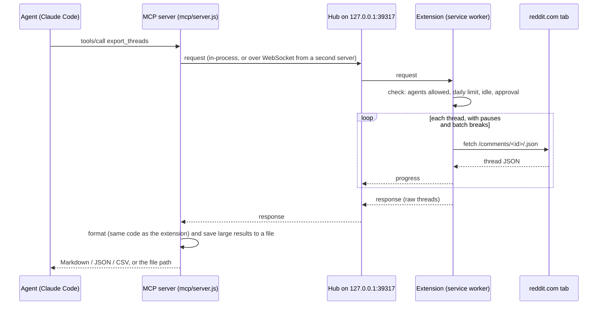

# Agent access (MCP)

AI agents such as Claude Code, Claude Desktop or Cursor can't click through a browser extension's
pages. Agent access gives them the same abilities through the
[Model Context Protocol](https://modelcontextprotocol.io): a small local MCP server talks to the
extension, and the extension does the work in your Chrome, exactly like the Export button does.

Nothing changes from Reddit's point of view: requests are made from a reddit.com tab, one at a time,
with the same pauses as a manual export. No page is clicked or changed.

## Set it up

1. **Install the server** (once). It lives in the `mcp/` folder of this repository:

   ```bash
   cd reddit-thread-exporter/mcp
   npm install
   ```

2. **Add it to your agent.** For Claude Code:

   ```bash
   claude mcp add thread-exporter -- node /absolute/path/to/reddit-thread-exporter/mcp/server.js
   ```

   For other clients, add an MCP server with the command `node` and the argument
   `/absolute/path/to/reddit-thread-exporter/mcp/server.js`.

3. **Allow agents in the extension.** Click the extension's toolbar button and click the
   **Agents off** pill next to the name, so it says **Agents on**. It turns green (**Connected**) once
   an agent with the server is running. The same switch, plus the limits, is in the exporter's
   **Agent access** card.

Chrome must be open with the extension enabled. The server only listens on your own computer
(`127.0.0.1`), so agents running in the cloud can't reach it.

## What agents can do

| Tool | What it does | Counts toward the daily limit |
| --- | --- | --- |
| `export_threads` | Fetches threads and returns them as Markdown, JSON or CSV. Large results are saved to a file and the path is returned. | Yes, one per thread |
| `find_threads` | Searches Reddit, optionally within one subreddit, and lists matching threads. | Yes, one per search |
| `get_exported_threads` | Returns threads you already exported in the extension. No new requests to Reddit. | No |
| `add_to_queue` | Adds links to the extension's queue, for you to export later. | No |
| `get_queue` | Lists the queue and each thread's status. | No |
| `get_status` | Connection, limits, today's usage, and whether an export is running. | No |

Agents can't change any settings. The limits below are yours.

## Limits and pacing

All limits are enforced inside the extension, so an agent can't get around them.

| Setting | Default | Where |
| --- | --- | --- |
| Pause between requests | 3 s | Options (applies to every export) |
| Batch size | 25 threads | Options (applies to every export) |
| Pause between batches | 30 s | Options (applies to every export) |
| Daily agent limit | 100 threads | Agent access |
| Threads per agent request | 25 | Agent access |
| Ask before each agent export | Off | Agent access |

While an agent is exporting, the toolbar badge shows **AI**, the popup and the exporter show its
progress, and the export button is paused until it's done. Manual and agent exports never run at
the same time. Every agent request is listed under **Recent agent activity**.

With **Ask before each agent export** on, a small window shows which threads the agent wants, and
nothing is fetched until you press **Allow**. Unanswered requests are denied after two minutes.

## Long exports

A request for 25 threads takes about two minutes with the default pauses, more with hidden replies or
an approval prompt. The server sends progress notifications, which most clients use to keep the
call alive. If your client still times out, raise its tool timeout (for Claude Code,
`MCP_TOOL_TIMEOUT=900000` for 15 minutes) or ask for fewer threads at a time.

## Configuration

| Environment variable | Default | Purpose |
| --- | --- | --- |
| `THREAD_EXPORTER_PORT` | `39317` | Local port shared by the server and the extension. If you change it, set the same port under **Agent access → Advanced** in the extension. |
| `THREAD_EXPORTER_OUTPUT_DIR` | `~/Downloads/Reddit Thread Exporter` | Where large results are saved. |
| `THREAD_EXPORTER_INLINE_LIMIT` | `60000` | Results longer than this many characters are saved to a file instead of being returned inline. |
| `THREAD_EXPORTER_EXTENSION_IDS` | – | Extra extension IDs to accept, comma-separated (for example a Chrome Web Store build). |

## How it works



Several agent sessions can run at once: the first server process opens the hub on the port, and
others connect to it as clients. If that process exits, the next one takes over the port.

## Bridge protocol

Reference for contributors. All messages are JSON over a WebSocket at `ws://127.0.0.1:<port>/`.

### Connecting

The role is passed in the query string: `?role=extension` or `?role=agent`. The hub rejects:

- any `Host` header other than `127.0.0.1:<port>` or `localhost:<port>`;
- `role=extension` unless `Origin` is `chrome-extension://<id>` for an accepted ID
  (`jjgnebbldngnhpdglbfiddkocigddhlb` by default, plus `THREAD_EXPORTER_EXTENSION_IDS`);
- `role=agent` when an `Origin` header is present (browsers always send one, local processes don't),
  so web pages can't connect.

A new extension connection replaces the previous one.

### Extension ↔ hub

| Direction | Message |
| --- | --- |
| extension → hub | `{ "type": "hello", "role": "extension", "version": "1.3.0" }` right after connecting |
| extension → hub | `{ "type": "ping" }` every 20 s; the hub answers `{ "type": "pong" }` (this also keeps Chrome's service worker awake) |
| hub → extension | `{ "type": "clients", "agents": [{ "name": "claude-code", "connectedAt": 1760000000000 }] }` whenever agent clients change |
| hub → extension | `{ "type": "request", "id": "h-17", "method": "export_threads", "params": { … }, "client": { "name": "claude-code" } }` |
| extension → hub | `{ "type": "progress", "id": "h-17", "message": "Exported 3 of 10", "done": 3, "total": 10 }` |
| extension → hub | `{ "type": "response", "id": "h-17", "ok": true, "result": { … } }` or `{ "type": "response", "id": "h-17", "ok": false, "error": { "code": "DAILY_LIMIT", "message": "…" } }` |

### Agent client ↔ hub

A second server process connects with `?role=agent`, sends `{ "type": "hello", "role": "agent", "name": "claude-code" }`,
then `request` messages with its own `id`. The hub forwards them to the extension under a hub-unique
ID and routes `progress` and `response` back with the original ID. `{ "type": "status" }` is answered
with `{ "type": "status", "extensionConnected": true, "extensionVersion": "1.3.0", "agents": 2 }`.

Hub-side errors: `EXTENSION_NOT_CONNECTED` (nobody to forward to) and `EXTENSION_DISCONNECTED`
(the extension went away while a request was pending). The hub sends `clients` as soon as the
extension connects and whenever an agent session connects, renames itself (a repeated `hello`) or
leaves; the list includes the hub process's own session first.

### Methods

| Method | Params | Result |
| --- | --- | --- |
| `status` | – | `{ version, busy: null \| "page" \| "agent", usage: { date, used, limit, remaining }, limits: { maxPerRequest, delaySeconds, batchSize, batchPauseSeconds, askBeforeExport }, queue: { waiting, done, failed } }` |
| `export_threads` | `{ links: string[], sort?: "confidence" \| "top" \| "new" \| "controversial" \| "old" \| "qa", loadHiddenReplies?: boolean }` | `{ threads: [{ link, ok: true, data: { listing, extraThings } } \| { link, ok: false, error }], notThreads: string[], duplicates: number, usage }` |
| `find_threads` | `{ query: string, subreddit?: string, sort?: "relevance" \| "top" \| "new" \| "comments", time?: "all" \| "year" \| "month" \| "week" \| "day", limit?: 1–25 }` | `{ results: [{ id, title, subreddit, url, score, comments, createdAt, snippet }], usage }` |
| `get_exported_threads` | – | `{ threads: [{ key, data: { listing, extraThings } }] }` |
| `add_to_queue` | `{ links: string[] }` | `{ added, duplicates, notThreads }` |
| `get_queue` | – | `{ items: [{ title, subreddit, url, status, comments, error }] }` |

`data.listing` is Reddit's raw thread response and `data.extraThings` the comments loaded from
"load more replies", the same shape the extension stores. The server formats them with
`src/lib/thread-model.js` and `src/lib/formatters.js`, so agent output matches the extension's files.

Extension error codes: `AGENTS_DISABLED`, `BUSY`, `DAILY_LIMIT`, `TOO_MANY_THREADS`, `NO_THREADS`,
`DENIED`, `RATE_LIMITED`, `BLOCKED`, `BAD_RESPONSE`, `BAD_REQUEST`, `UNKNOWN_METHOD`, `INTERNAL`.
Hub error codes: `EXTENSION_NOT_CONNECTED`, `EXTENSION_DISCONNECTED`, `TIMEOUT` (no answer within
30 minutes) and `BAD_REQUEST`.
