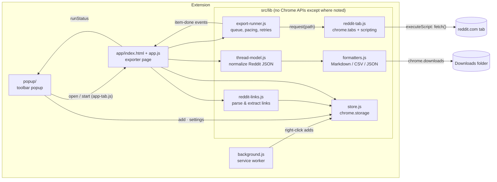
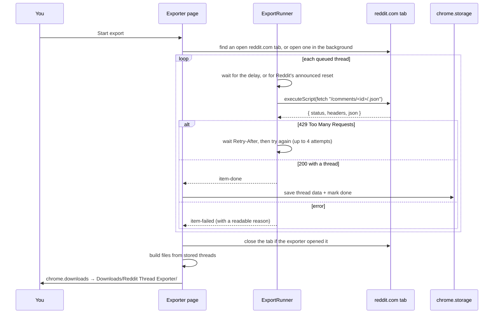

# Architecture

Thread Exporter is a Manifest V3 Chrome extension written in plain JavaScript modules. There is no bundler and no runtime dependency: the files in `src/` are exactly what Chrome runs.

## The pieces

| File | Responsibility | Uses Chrome APIs |
| --- | --- | --- |
| `src/background.js` | Right-click menu, badge count, opens the exporter on install | yes |
| `src/popup/popup.js` | Toolbar popup: add the current thread, quick add, queue counts and progress, quick settings | yes |
| `src/app/app.js` | The exporter page: renders state, handles input, runs exports, saves files | yes |
| `src/lib/app-tab.js` | Opens or focuses the single exporter tab and passes it a command (start, help) | yes |
| `src/shared/theme.css`, `icons.svg`, `ui.js` | Design tokens and components, the icon sprite, and small DOM helpers shared by the page and the popup | DOM only |
| `src/lib/reddit-links.js` | Recognises every Reddit link format and finds links in any text | no |
| `src/lib/export-runner.js` | Works through the queue with pacing, rate-limit handling, retries, pause and stop | no |
| `src/lib/thread-model.js` | Turns Reddit's nested `Listing` JSON into a small documented tree | no |
| `src/lib/formatters.js` | Builds the Markdown, CSV and JSON files | no |
| `src/lib/reddit-tab.js` | Finds or opens a reddit.com tab and runs `fetch` inside it | yes |
| `src/lib/store.js` | Queue, settings and downloaded data in `chrome.storage.local` | yes |

Everything without Chrome APIs is covered by unit tests (`npm test`, Node's built-in test runner).

## How an export runs

## Design decisions

**Requests run inside a reddit.com tab.** Reddit blocks most requests that don't come from a real browser session (plain `curl`, scripts, headless browsers). The original version of this tool was a script pasted into the DevTools console on reddit.com for exactly that reason. The extension does the same thing automatically: `chrome.scripting.executeScript` runs a tiny `fetch` function in the tab, so each request is same-origin, carries the normal cookies, and looks like Reddit's own page loading comments. The extension never reads the cookies itself.

**One injection per request.** Instead of injecting one long-running script, the runner injects a small function for every request. The loop, timing and retry logic stay in the extension page, where they can be paused, stopped and tested, and a closed or reloaded Reddit tab only costs one retry.

**The runner doesn't know about Chrome.** `ExportRunner` receives a `request(path)` function and reports progress through DOM events (`item-start`, `item-done`, `item-failed`, `wait`, `log`, `state`, `finished`). The app passes the real tab bridge; the tests pass a fake one with a fake clock, which makes rate-limit and retry behaviour easy to test.

**Polite by default.** One request at a time, a configurable pause (2–10 s, default 3 s), and Reddit's rate-limit headers are respected: `Retry-After` on HTTP 429, and `x-ratelimit-remaining` / `x-ratelimit-reset` when the budget runs out. Waits are capped at 10 minutes.

**Finished work is never lost.** Each thread is saved to `chrome.storage.local` the moment it finishes. Closing the tab, stopping, or a crash keeps everything already exported; items left in `running` go back to `queued` on the next start. Queue writes go through a promise chain so quick successive updates can't overwrite each other.

**The popup delegates, the page works.** A Chrome popup closes the moment it loses focus, so it can't run an export. It edits the same settings and queue in storage, and its Export button opens (or focuses) the exporter page and tells it to start, either with a runtime message (tab already open, sender ID checked) or a `?start=1` parameter (new tab). The page publishes its progress to `chrome.storage.session`, which the popup reads to show a live progress bar.

**Raw data is stored, formats are built on demand.** Storage keeps Reddit's original response. The Markdown, CSV and JSON files are generated at download time, so changing a format option (for example, including usernames) applies to threads exported earlier too.

**Untrusted text stays text.** Titles and comments are only ever written with `textContent`, and ESLint rejects `innerHTML`-style APIs. Extension pages run under a strict CSP (`script-src 'self'; object-src 'none'; base-uri 'none'; frame-ancestors 'none'`). CSV cells are protected against formula injection and exported links are limited to reddit.com permalinks and http(s) URLs. The full threat model is in [SECURITY.md](../SECURITY.md).

## Storage layout

`chrome.storage.local` (with `unlimitedStorage`, since large threads can be several MB):

| Key | Value |
| --- | --- |
| `queue` | `QueueItem[]`: `{ key, ref, title, subreddit, status, error, comments, addedAt, fetchedAt }` |
| `settings` | `{ formats, sort, delaySeconds, expandMore, includeUsernames, autoDownload, fileName, theme, welcomeDismissed }` |
| `thread:<key>` | `{ listing, extraThings }`: Reddit's thread response plus comments loaded from "load more replies" |

`chrome.storage.session` (cleared when the browser restarts):

| Key | Value |
| --- | --- |
| `runStatus` | `{ state, finished, total, current }`: progress of the running export, shown in the popup |

## Reddit endpoints used

| Endpoint | Purpose |
| --- | --- |
| `GET /comments/<id>/.json?limit=500&sort=<sort>&raw_json=1` | The post and up to ~500 comments |
| `GET /api/morechildren.json?api_type=json&link_id=t3_<id>&children=<ids>` | Comments behind "load more replies" (only with **Load hidden replies** on), up to 100 per request and 10 requests per thread |
| `GET /r//s/<code>` | Share links: only the redirect target is used |
